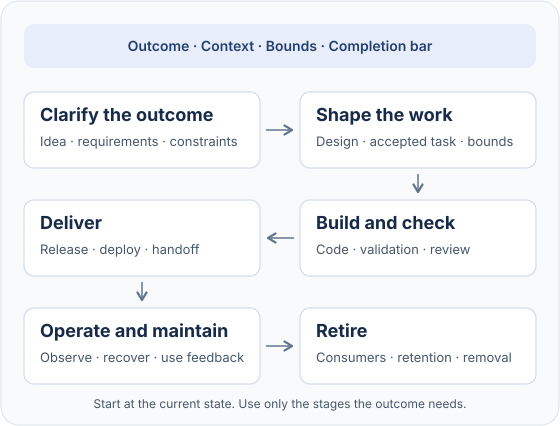

# OutcomeBound

[](https://github.com/rajasdevel/outcomebound/actions/workflows/ci.yml)

**Work sized to the outcome. Evidence for each step.**

OutcomeBound gives your coding agent a 300-word contract, fourteen skills it reads when a task
needs them, and engine checks that run your project's own commands. The agent does the engineering
that the outcome needs: no less, and no more. It holds only the decisions that are yours, and it
reports what is true, what is not done, and which check shows it.

It works through the harness you already use (Claude Code, Codex, Cursor, Gemini CLI, Amp). The
engine is Python standard library only, and it never runs your agent.

[A day with OutcomeBound](#a-day-with-outcomebound) · [Quick start](#quick-start) ·
[What you get](#what-you-get) · [How it works](#how-it-works) ·
[Evidence and limits](#evidence-and-limits) · [Harness support](references/portability.md)

## A day with OutcomeBound

Here is one working day on a small project, `shelf`, a reading list on the command line. Ticket
#12 asks for a CSV export. The project, its tickets and the times are made up. Every command and
every output below is from a real run of OutcomeBound 1.8.0; long paths are shortened and some
lines are cut, where `…` shows.

**9:00 — Is the install current?** You pulled overnight and a teammate upgraded the engine.

```console
$ outcomebound adopt . --check
current  AGENTS.md (operating-contract)
current  AGENTS.md (project-facts)
…
current  .claude/skills/review-council/SKILL.md
…
note     Cloud sessions start from a fresh clone, … Add one of these lines to the cloud environment's setup step (this writes no file):
note       uv tool install outcomebound==1.8.0
note       python3 -m pip install outcomebound==1.8.0
note     Where each harness keeps that step:
note       Claude Code on the web: the cloud environment's setup script
note       Codex cloud: the environment's setup script
note       GitHub Copilot: .github/workflows/copilot-setup-steps.yml
```

Everything is current, and the check tells you the one line a cloud session needs. If another
worktree of the project still has an older install, the check prints a `warn` line for it.

**10:30 — The agent needs your call.** You ask the agent to build the export. It writes the code
and the tests, then stops at a question that is not its to answer: should a reader's private
notes go into a file that people share? It goes on with the work that does not wait, and puts the
question to you as a decision brief:

> ### D1 · Should the CSV export include each book's private notes?
>
> ⏳ Waiting on this: ticket #12, the export; until you answer, the export leaves notes out
>
> Readers keep private notes on a book, such as `re-read in winter`.
>
> A CSV file is often shared, or uploaded to a spreadsheet service.
>
> - Notes out: the file holds only title and author.
> - Notes in: the file holds every note, and anyone the file reaches can read them.
>
> 🗺️ One row of the export
>
> ```text
> title, author          <- always
> title, author, notes   <- only with --with-notes
> ```
>
> 🧪 Explore: try each option on a sample list and see the file each one writes · reply `explore D1` for an interactive page
>
> **Options**
>
> - **A · leave notes out** — the file holds title and author only
>   - ⭐ Recommended: a file that is shared should not carry private text by default · my judgment
>   - ⚖️ Choose if: exports are shared or uploaded
>   - 🔻 Downside: a reader who wants a full backup waits for a later option
> - **B · add a --with-notes flag** — notes go out only when the reader asks
>   - ⚖️ Choose if: readers need full backups now
>   - 🔻 Downside: one more option to document and test
> - **C · always include notes** — the file is a full backup
>   - 🔻 Downside: private text leaves the machine with no choice
>
> ✅ Checked: `make test` passes with notes left out
>
> ↩️ Undo: a flag can be added later without breaking a file

The brief reads in the order you decide: the question, what waits on it, the context, a picture,
the options with the recommendation on its option, when to choose each one and its downside, then
the evidence and the way back. The agent writes a JSON document and `outcomebound brief` draws it,
so every brief has the same shape. The marks are emoji where your terminal can show them, and
plain text where it cannot.

You want to try the numbers first, so you reply `explore D1`. The agent builds a page with
`outcomebound explorable`, checks it in a browser, and gives you one HTML file to open from disk.
The page draws the same brief, then lets you change the values:


The page holds no network call. You copy your reply from it, and nothing leaves the page on its
own.

**12:00 — Lunch, and the agent's context compacts.** When you come back, neither of you remembers
exactly where things stand. One command reads it from what the project keeps:

```console
$ outcomebound where --offline
where: 10 line(s): 3 OPEN, 5 NOTE, 2 UNVERIFIED (a report; it decides nothing)
NOTE        git csv-export: branch csv-export, no upstream, 0 uncommitted path(s) [git]
UNVERIFIED  pr: --offline: gh was not run [gh pr list]
NOTE        ticket: 2 open ticket(s); export written 0m ago [issues.json]
NOTE        ticket #12: "Export the reading list as CSV" waits on brief(s) D1 (an answer in a ticket comment is not read) [issues.json]
OPEN        ticket #13: "Import a CSV reading list" is ready: no hold, no open blocker [issues.json]; next: hand-off-tickets
UNVERIFIED  ticket: whether a ticket is claimed: the pinned export carries no assignee or comment [issues.json]
NOTE        validation: 3 claim(s): 0 CURRENT, 0 CHANGED, 3 UNVERIFIED (3 with no result kept) [.outcomebound/ticket-claims.json]
OPEN        review: DISPOSITION_UNKNOWN [.agents/work/csv-export/review.md]; next: review-findings
OPEN        brief D1: "Should the CSV export include each book's private notes?" has no Decided line (#12 waits on it); waiting on it: ticket #12, the export; until you answer, the export leaves notes out [.agents/work/csv-export/briefs.json]; next: decision-brief
NOTE        handoff: newest handoff of the folder (it may belong to another task), written 0m ago; 2 commit(s) on HEAD since by commit date, which a rebase moves; it is a claim, check its facts against the lines above [.agents/handoffs/2026-10-19-csv-export.md]
Does not establish: that a line is current beyond the moment it was read: …
```

Each line names its source and a verdict, and each unfinished item names the skill for its next
step. Three things are open: your answer to D1, a review finding with no disposition, and ticket
#13. `where` writes nothing and no hook runs it. Without `--offline`, it also asks `gh` for the
open pull requests.

**13:15 — You answer.** You pick A. The agent records your words in one line, and the brief is no
longer open:

```console
$ tail -1 .agents/handoffs/2026-10-19-csv-export.md
Decided: D1 · A · maintainer · 2026-10-19 · "leave them out; a flag can come later"
$ outcomebound brief open
0 open brief(s); 0 collision(s)
```

Next week, `outcomebound brief lookup notes` finds the brief and the answer again, by id or by
words.

**15:00 — A second opinion before it lands.** The agent fixed the review finding (a title with a
comma must stay one cell) and wrote its disposition. The export leaves a reader's machine, so the
agent asks for a review by a different harness. First it shows you the plan, and nothing runs:

```console
$ outcomebound review council --plan --base main
COUNCIL PLAN (nothing has run)
This run spends the person's credits: every reviewer below starts a model run on the person's own login or key. Run it only after the person says yes to this plan.
reviewers from: the built-in default council
…
reviewing: the changes in main...HEAD, at revision 1cdc50777cab…
lens: anything that makes the change fail its purpose, a claim it makes that its text or tests do not support, and a case it misses
…
snapshot: …, the files of the revision with no Git history, made for the run and removed after it; it leaves out the instruction files and folders a harness would load (.cursorrules, AGENTS.md, …, .claude, .codex, …)
the diff and the files go to each reviewer as quoted data between marked lines, labelled as data and not instructions; a reviewer's answer is never run

reviewer r1: codex:<model>:high
  …
  argv: codex exec -s read-only --ephemeral --ignore-user-config --ignore-rules -c features.memories=false …
  …
  timeout: 1800 s, then the process and its children are killed
  …
  read-only safeguards, each read from the source on the date, and shown by a run only where `run` says tested (else UNVERIFIED):
    -s read-only: the sandbox lets no command the model runs write a file [help: listed, run: UNVERIFIED, …]
    --ephemeral: no session files are kept [help: listed, run: tested, …]
    …
…
plan id: cf1fc8277188
To run it, after the person says yes: the same command with --accept in place of --plan and --plan-id cf1fc8277188 added; a run that differs from this plan is refused.
```

You see the exact command line, what keeps it read-only and what is not yet shown, and that it
spends your credits. You say yes, and `--accept --plan-id cf1fc8277188` runs that plan and no
other. Each reviewer that answers writes one review file, and the agent gives each finding a
disposition.

**16:30 — Proof for the ticket.** Ticket #12 names the claims that show it is done. The agent runs
those claims, and only those, against a fresh export of the tickets (`issues.json`):

```console
$ outcomebound tickets verify --input issues.json 12
PASS export-round-trips [test, required] — declared check exited 0; addresses: a re-imported list loses a book
PASS notes-stay-private [test, required] — declared check exited 0; addresses: private notes leave the machine in an export
VERDICT: PASS (done-when of #12: 2 PASS)
```

Each attempt is kept beside the plan, and a later attempt never writes over an earlier one. A
`PASS` shows that the claims pass. It does not show that the work landed: the pull request, its CI
and its merge are separate states, and the agent reports each one as its own.

That is the day: one decision put to you with what waits on it, your place found again after a
break, a second opinion that you approved first, and a ticket closed on evidence.

## Quick start

You need Python 3.10 or later, Git 2.52.0 or later, and a Git work tree.

```sh
uv tool install outcomebound==1.8.0
cd your-repo
outcomebound adopt . --detect       # writes nothing; prints the install command for your files
```

For a Python project with a `make test` target and both harnesses' folders, it prints:

```sh
outcomebound adopt . --harness claude-code,codex --fragments python,commands --done 'make test'
```

Run that command, read the diff, and commit the files. The install writes no hook and runs no
command of yours. Start a new agent session, and add `outcomebound adopt . --check` to CI to catch
stale or edited managed files.

To install only the facts of your project, add `--facts-only`. `AGENTS.md` then gets the project
facts and your `local` fragment, and no operating contract and no pointers. The skills go only to
a harness that lists skills itself. Later runs keep this mode, and `--full` returns to the full
install. An engine before this mode installs in full when it runs, so first move every pin of the
engine (CI, each machine) to a release that has the mode.

You can also give the whole onboarding to your agent: ask it to follow the guide that `--detect`
names. It proposes only the project facts an agent would otherwise get wrong, each with the file
that shows it, and asks you once for what the repository cannot show.

### Start a new project

```sh
mkdir my-app && cd my-app && git init
outcomebound scaffold . --lifecycle solo --visibility private         # the plan; writes nothing
outcomebound scaffold . --lifecycle solo --visibility private --accept
outcomebound scaffold . --lifecycle solo --visibility private --check # the values left to fill
```

The plan names each file, each platform act and who does it (a branch rule, a secret scan), and
the `adopt` command for the lifecycle. The scaffold writes only absent files, never edits a present
one, and installs nothing. Then ask your agent to start the project: the
[new-project reference](skills/using-outcomebound/references/new-project.md) sizes the idea, tests
what could end it, and builds a walking skeleton with a Done command that can fail.

### Upgrade or remove

```sh
uv tool install --force outcomebound==1.8.0
outcomebound adopt .          # every managed file current; an edited block is kept unless --force
outcomebound adopt . --remove # takes out what the install owns
```

After an upgrade, `adopt --check` reads the operating-contract block, and each managed file that the
release changed, as `stale` until `adopt` runs. The `version` verb prints the engine version and the
folder of its files. The finish-check hook entries that 1.6.0 and earlier wrote do nothing from
1.7.0, and `adopt` takes them out. `adopt` also prints the install line for a cloud session, and
`adopt --check` warns of each other worktree whose install is older than the engine. The
[cloud guide](docs/cloud-sessions.md) says what a cloud session starts with and where each harness
keeps the setup step that installs `outcomebound`.

<details>
<summary>Other installers and environment requirements</summary>

`pipx install outcomebound==1.8.0` also works, or `python -m pip install outcomebound==1.8.0`
inside an activated virtual environment. Each release is on PyPI from 1.6.0; the tagged Git URL
(`git+https://github.com/rajasdevel/outcomebound@v1.8.0`) installs the same release, and every
earlier one. These commands work in PowerShell, cmd and POSIX shells; detection prints commands
for POSIX shells and PowerShell. On Windows, install [Git for Windows](https://gitforwindows.org).
`pip install --user` is not supported. If the environment sets `PYTHONPATH`, use absolute folders
only. See [dependencies and portability](docs/dependencies.md).

</details>

## What you get

| Feature | What it does |
| --- | --- |
| **The contract** | A short block in `AGENTS.md`: frame each task by outcome, context, bounds and completion bar; size the plan to the risk; never claim a check that did not run. |
| **Skills on demand** | Requirements, decision briefs, tests, diagnosis, review (and a council of other reviewers), specs, tickets, hand-offs, landing, acceptance and more. Each loads only when its trigger matches. |
| **Decision briefs** | An act outside the agent's authority comes back as a question, what waits on it, the context, options with the recommendation marked on its option, evidence and an undo line. Other work continues. A hard choice can get an interactive page, and `brief open` and `brief lookup` find what is still unanswered and what was decided. |
| **Find your place** | `outcomebound where` reads Git, pull requests, tickets, validation results, reviews, briefs and the newest handoff, and prints what is in flight after a pause or a compaction. |
| **Second opinions** | `outcomebound review council` plans a read-only review by other harnesses and models, shows you the plan and its cost, and runs only after you say yes. |
| **Ticket hand-off and proof** | Slice work into outcomes you accept, hand each one to an implementer with the detail its tier needs, and run the claims a ticket names with `tickets verify`. |
| **Lifecycle scaffold** | `outcomebound scaffold` writes the files a prototype, solo, team or organization project needs, and lists each value still to fill. |
| **Quality floor** | Keep old lint and type debt visible, reject new findings, and make each loosening a recorded decision. |
| **Instruction check** | Read agent instructions for hidden characters, override phrases and risky settings. |

## From idea to delivery



A local bug fix goes straight to its regression check. An export feature keeps its format and
privacy constraints with the accepted work, lands through your route, and checks the delivery.
The [lifecycle reference](skills/using-outcomebound/references/lifecycle.md) gives the evidence
and hand-offs for each stage. Your project records its own lifecycle in a few lines.

## How it works

The contract frames each task with four inputs:

| Input | Question it answers |
| --- | --- |
| **Outcome** | What must become observably true, and for whom? |
| **Context** | What do the code, runtime and evidence show? |
| **Bounds** | What work and authority are granted, and what state must be preserved? |
| **Completion bar** | Which result and checks establish success for this change? |

The agent decides what it can, states its assumptions, and adds a spec, a test first, a review or a
wider check only when the outcome and risk need one. Your project's required process stays
required; process a document only suggests is sized to the task.

The agent never claims a check that did not run, and always reports a failure. A label or id you
did not use is explained in plain words or left out. Committed, pushed, deployed and observed are
separate states.

OutcomeBound installs no hook. The project facts name the Done commands as the full suite; the
agent runs them where the change's risk reaches them, the project requires them, or the work
lands. A record another reader acts on, such as a pull request description or a handover, gives
each check as `PASS`, `FAIL` or `UNVERIFIED`; a reply in conversation says it in plain words. Read
the [contract block](templates/managed-block.agents.md.tmpl) and the
[full operating contract](OutcomeBound.md).

## Commands

The commands an agent or a person uses most between install and landing. `outcomebound <verb>
--help` gives the details of each.

| Command | What it tells you |
| --- | --- |
| `outcomebound where` | Writes nothing. One line for each open item (pull requests, tickets, worktrees, validation results, reviews, decision briefs, the newest handoff), with its source and a verdict, and the skill that serves the next step; see the [lifecycle design](docs/specs/lifecycle/design.md). |
| `outcomebound brief open` / `brief lookup` | Writes nothing. The decision briefs with no recorded answer; one brief, found by id or words, with its answer. |
| `outcomebound tickets verify <ticket>` | Runs the claims that one ticket's `done-when` names, and only those, and keeps each attempt as `validation` keeps it. It runs the plan's commands, so run it only for a plan you trust; see the [ticket guide](docs/tickets.md). |
| `outcomebound validation status <plan>` | For each claim of a validation plan: still current, changed since its last pass, or not shown. Runs nothing. `validation --claim NAME` runs one claim; see the [floor design](docs/specs/floor/design.md). |
| `outcomebound review council --plan` | How reviewers of other harnesses and models would review a change, read-only. Runs nothing. `--accept` runs them and spends your credits, so run it only after you have seen the plan and said yes; see the [review design](docs/specs/review/design.md) and the [review-council skill](skills/review-council/SKILL.md). |
| `outcomebound review check <file>` / `review since <file>` | Whether each finding has a disposition (accounting, not correctness); what changed since the ref the review read. |
| `outcomebound sources check` / `sources links <path>` | A digest for each source (accounting, not correctness); each broken link or reference in Markdown files. |
| `outcomebound size [--base REF]` | How many lines the work tree adds and removes against a base (for stability work, the release tag in production), and how many are code, tests, docs, config or records; see the [size design](docs/specs/size/design.md). |
| `outcomebound workspace audit` | Each worktree's commits (merged, pushed or local), changed and untracked paths, age and size, and which pass the mechanical removal rule. Removes nothing; see the [workspace design](docs/specs/workspace/design.md). |
| `outcomebound floor propose` / `floor apply` | `floor propose . > floor.json`, then `floor apply . --floor floor.json --accept` records the quality floor; see the [floor design](docs/specs/floor/design.md). |

## More

- **Hand off to a smaller model:** the [ticket guide](docs/tickets.md) and the
  [hand-off skill](skills/hand-off-tickets/SKILL.md).
- **Text for people:** `adopt --human-style ste` asks for ASD-STE100 Simplified Technical English
  in documents a person keeps, such as pull request descriptions, commit messages, specs and
  handovers, and not in replies in conversation.
- **Workspace and commands:** the [workspace guide](docs/workspace.md) and the
  [command guide](docs/commands.md).
- **Private skills and tools:** keep them in your own private repository and link them into your
  user-level folders, never a project: the [private kit guide](docs/private-kit.md).
- **Research:** the [research library](https://github.com/rajasdevel/outcomebound-research) holds
  dated model, harness and practice evidence; `outcomebound research <path>` returns a file with
  its commit and digest. Cite the file by its path, that commit and that digest in a record.
- **Business requirements kit:** [`kits/business-requirements/SKILL.md`](kits/business-requirements/SKILL.md),
  attached to each release, for a Business Owner to paste into their own assistant. `adopt` does
  not install it.

## Evidence and limits

Each claim of a measured effect links to its run in the
[evaluation record](docs/evaluations.md), with its model, its arms and its limits:

- Small tasks: comparisons showed less suggested process with correct changes kept; other
  comparisons passed on both sides and showed no gain ([E7 and E10](docs/evaluations.md)).
- Onboarding guide: 2 of 3 runs passed with it and 0 of 3 without it, on Claude Sonnet 5.5
  ([E23](docs/evaluations.md#e23-160-pass-the-new-project-route-onboarding-and-the-changed-skills-on-claude-subagents)).
- New-project reference: 3 of 3 with it and 0 of 3 without it on a weak idea and on a spike that
  misses its bar ([E23](docs/evaluations.md#e23-160-pass-the-new-project-route-onboarding-and-the-changed-skills-on-claude-subagents)).

These are bounded observations, not proof of general reliability. The engine's own behaviour is
held by its test suite. An install does not prove that a native session loaded a skill: the
[harness guide](references/portability.md) separates configuration from observed
behaviour. The instruction check is lexical, and a person judges its findings. Your permissions,
harness trust and branch protection enforce authority; OutcomeBound's checks inform decisions.

## Contributing and license

See [CONTRIBUTING.md](CONTRIBUTING.md) (DCO sign-off, no CLA) and [SECURITY.md](SECURITY.md).
Apache-2.0, with one exception: the text that `adopt` writes into your repository carries no
license-copy, changed-file notice or NOTICE duty (Sections 4(a), 4(b) and 4(d); see
[LICENSE](LICENSE)). The license grants no right to use the OutcomeBound name (Apache-2.0
Section 6). You can say that a project uses OutcomeBound, and a fork ships under its own name.
Claude Code, Codex, Cursor, Gemini CLI, Amp and other product names belong to their owners;
OutcomeBound is not affiliated with them.

## Acknowledgements

Ideas in OutcomeBound come from these repositories. The text is our own. None of them is
affiliated with OutcomeBound or endorses it:
[obra/superpowers](https://github.com/obra/superpowers),
[mattpocock/skills](https://github.com/mattpocock/skills),
[anthropics/skills](https://github.com/anthropics/skills),
[agentsmd/agents.md](https://github.com/agentsmd/agents.md),
[agentskills/agentskills](https://github.com/agentskills/agentskills),
[cloudflare/security-audit-skill](https://github.com/cloudflare/security-audit-skill),
[cathrynlavery/diagram-design](https://github.com/cathrynlavery/diagram-design),
[UKGovernmentBEIS/inspect_ai](https://github.com/UKGovernmentBEIS/inspect_ai),
[addyosmani/agent-skills](https://github.com/addyosmani/agent-skills),
[DietrichGebert/ponytail](https://github.com/DietrichGebert/ponytail),
[worrydream/Tangle](https://github.com/worrydream/Tangle).
The research library's [credited ideas](https://github.com/rajasdevel/outcomebound-research/blob/main/practices/skills.md)
page records the sources.
